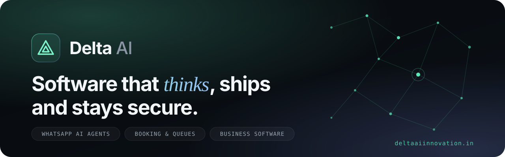
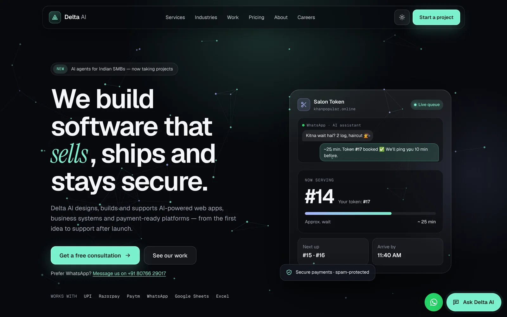
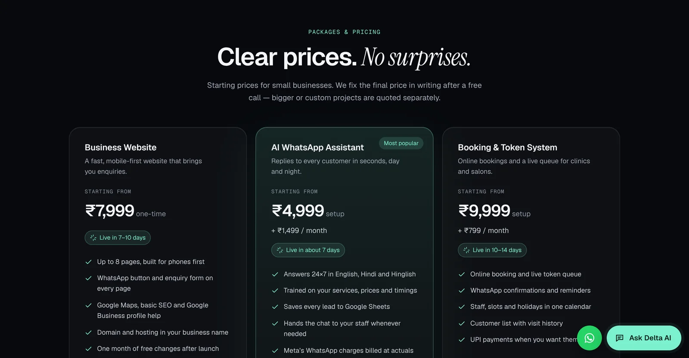
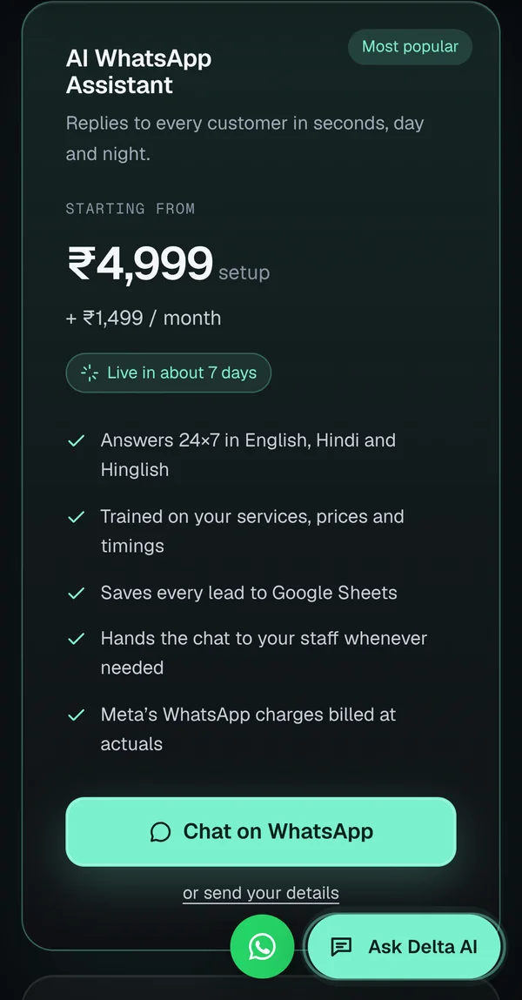
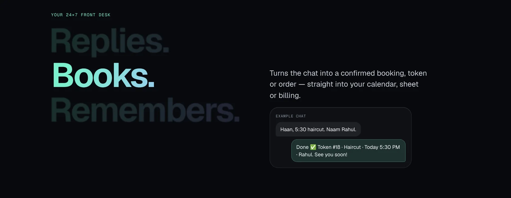
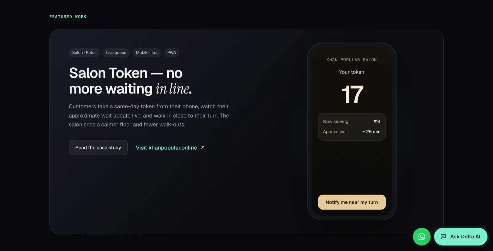
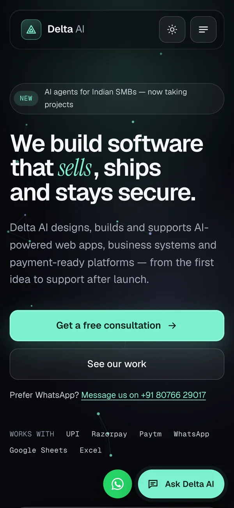
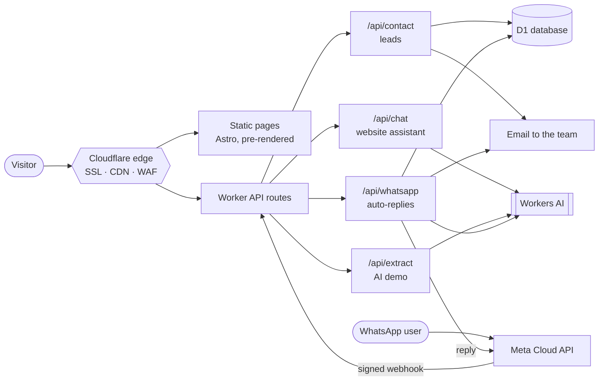

<div align="center">

<a href="https://deltaaiinnovation.in">
  
</a>

<br />

**The website and AI front desk of [Delta AI Innovation](https://deltaaiinnovation.in)** — WhatsApp AI assistants, booking systems and business software for Indian businesses.

<br />

[](https://deltaaiinnovation.in)
[](https://github.com/A-nkitPandey/delta-ai-web/actions/workflows/ci.yml)


[**Visit the site**](https://deltaaiinnovation.in) &nbsp;·&nbsp; [Pricing](https://deltaaiinnovation.in/#pricing) &nbsp;·&nbsp; [Our work](https://deltaaiinnovation.in/work) &nbsp;·&nbsp; [Run & deploy guide](docs/DEPLOY.md)

</div>

<br />



## ✦ What's inside

<table>
  <tr>
    <td width="50%" valign="top">
      <h3>🤖 AI assistant, everywhere</h3>
      A website chat and a <b>WhatsApp auto-reply</b> that answer in English, Hindi and Hinglish — grounded only in the site's own content, running on Cloudflare Workers AI.
    </td>
    <td width="50%" valign="top">
      <h3>✨ Live “Try our AI” demo</h3>
      Paste a messy customer message (<i>“kal 5 baje 2 log”</i>) and watch it turn into a clean booking plus a reply in the customer's own language.
    </td>
  </tr>
  <tr>
    <td valign="top">
      <h3>💬 WhatsApp-first conversion</h3>
      Floating WhatsApp button that knows which page you were on, package buttons with pre-filled messages, and a one-tap hand-off from the AI chat.
    </td>
    <td valign="top">
      <h3>₹ Open, honest pricing</h3>
      Starter packages and care plans with clear starting prices, delivery times and GST notes — all edited from one JSON file.
    </td>
  </tr>
  <tr>
    <td valign="top">
      <h3>🛡️ Secure by default</h3>
      Hash-based CSP, HSTS, Turnstile bot checks, rate limits, signed WhatsApp webhooks, salted IP hashes and secrets kept out of code.
    </td>
    <td valign="top">
      <h3>⚡ Fast on any phone</h3>
      Pre-rendered pages, self-hosted fonts and almost no JavaScript — built for low-end Android phones and patchy networks.
    </td>
  </tr>
</table>

## ✦ A look around

<table>
  <tr>
    <td width="66%"></td>
    <td width="34%" rowspan="2"></td>
  </tr>
  <tr>
    <td></td>
  </tr>
  <tr>
    <td></td>
    <td></td>
  </tr>
</table>

## ✦ Architecture



| Layer | Choice | Why |
|---|---|---|
| Framework | **Astro 7** + TypeScript (strict) | Pre-rendered HTML, content collections with build-time validation |
| Hosting | **Cloudflare Workers** + static assets | Free plan, global edge, one deploy for pages and APIs |
| AI | **Workers AI** (Llama 3.3 70B with fallbacks) | Free daily allowance, no external AI keys |
| Data | **Cloudflare D1** | Leads and WhatsApp chat history (auto-deleted after 30 days) |
| Messaging | **WhatsApp Cloud API**, Cloudflare Email | Replies where Indian customers already are |
| Protection | Turnstile, rate limiting, CSP | Spam and abuse stopped before they cost anything |

## ✦ Project structure

```text
src/
├─ content/            ← all copy, prices, services, case studies (edit these, not code)
├─ components/         ← sections: Hero, Packages, ChatWidget, AiDemo, StorySection …
├─ pages/
│  ├─ api/             ← contact · chat · extract · whatsapp (Worker endpoints)
│  ├─ services/  industries/  work/   ← one page per content file
│  └─ about · careers · partners · privacy · terms
├─ lib/                ← site settings, shared AI assistant, WhatsApp helpers
└─ styles/global.css   ← design tokens (colours, type, radii)
migrations/            ← D1 schema
.github/workflows/     ← CI (type check, build, audit) and a live smoke test
```

## ✦ Quick start

```bash
npm install
cp .dev.vars.example .dev.vars      # local test keys
npm run db:migrate:local            # local D1 tables
npm run dev                         # http://localhost:4321
```

`npm run check` type-checks everything · `npm run build` builds for Cloudflare.
Full setup — domain, database, secrets, WhatsApp and Google — is in **[docs/DEPLOY.md](docs/DEPLOY.md)**.

## ✦ Quality gates

- **CI on every push and pull request:** `astro check`, production build and `npm audit` (high/critical).
- **Dependabot:** weekly npm updates, monthly GitHub Actions updates.
- **Live smoke test:** a manual workflow that waits for the deploy and asks the live AI chat a question.
- Every push to `main` deploys automatically through Cloudflare Workers Builds.

## ✦ Security

Found a vulnerability? Please read **[SECURITY.md](SECURITY.md)** and report it privately — don't open a public issue.

## ✦ License

© 2026 Delta AI Innovation. All rights reserved — see [LICENSE](LICENSE). The code is public so you can read how it's built; please don't reuse the brand, content or design.

<div align="center">
<br />
<sub>Built in New Delhi 🇮🇳 &nbsp;·&nbsp; <a href="https://deltaaiinnovation.in">deltaaiinnovation.in</a> &nbsp;·&nbsp; <a href="https://www.linkedin.com/company/deltaaiinnovation">LinkedIn</a></sub>
</div>
